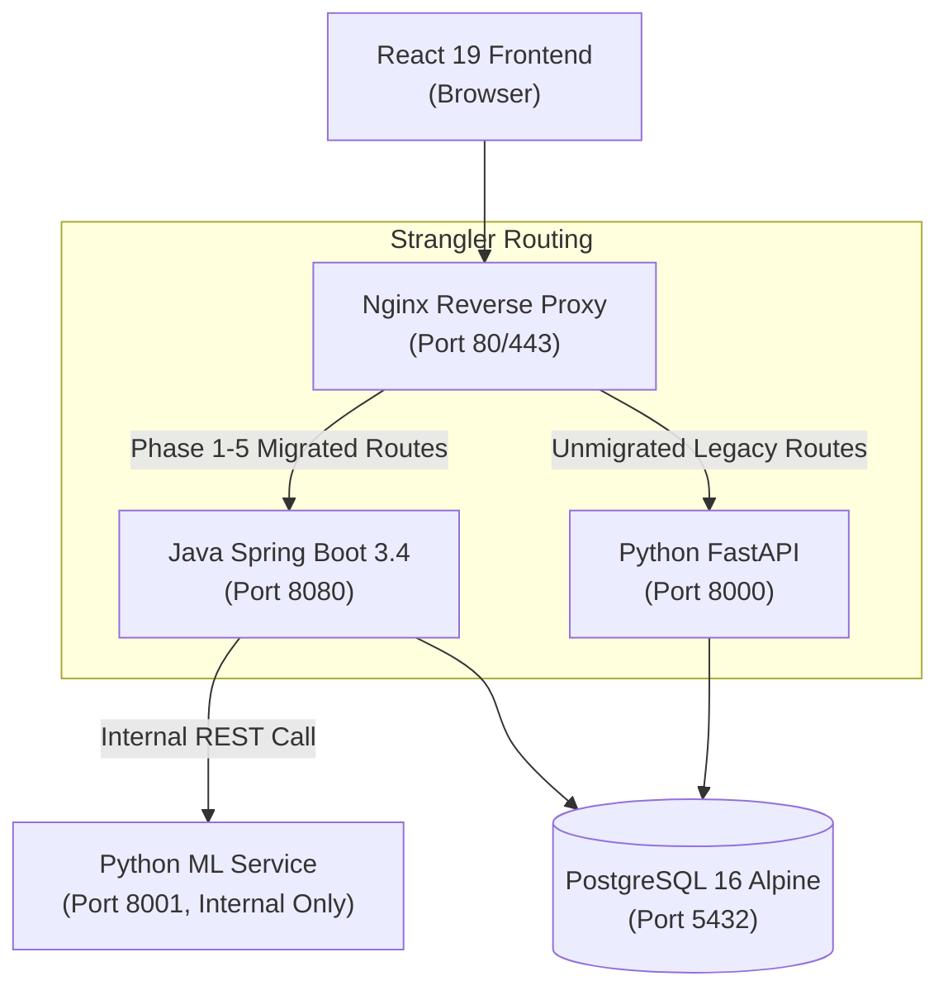
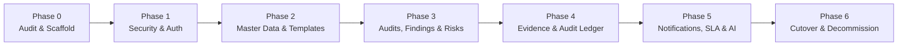

# Java Spring Boot Backend Migration: Comprehensive Phase Plan
**Platform:** CompanyAudit — Enterprise Audit & Performance Analytics Platform  
**Architecture Transition:** Python 3.13 / FastAPI -> Java 17/21 LTS / Spring Boot 3.4.x  
**Deployment Pattern:** Strangler Fig with Reverse Proxy Path Routing  
**Database Rule:** PostgreSQL 16 100% Retained (Zero DDL Mutations)  
**Deliverable ID:** PHASE0-DELIV-07

---

## 1. Executive Summary & Migration Methodology

The migration of CompanyAudit's backend replaces the FastAPI runtime with an enterprise-grade Java Spring Boot application while keeping the **React 19 frontend** and **PostgreSQL 16 database** completely intact.

To eliminate service disruption, the migration follows the **Strangler Fig Pattern**:
- An Nginx reverse proxy routes traffic transparently.
- Phase by phase, specific API route families are diverted from the legacy Python service (port `8000`) to the new Spring Boot service (port `8080`).
- The Python backend continues servicing remaining routes until 100% endpoint parity is verified.
- The Python Scikit-learn AI capabilities are retained as an internal, authenticated microservice invoked exclusively by Spring Boot.

---

## 2. Complete Phase Roadmap & Work Breakdown

---

### Phase 0: Repository Audit, Scaffolding & Specifications (COMPLETED)
- **Objective:** Establish Maven scaffold, verify runtime compatibility, audit API contracts, and construct cryptographic parity baselines.
- **Key Deliverables Completed:**
  1. `backend-java/pom.xml` with Spring Boot 3.4.0, Java 17 LTS, Security, JPA, Flyway, JJWT, Bouncy Castle, POI, OpenPDF, Bucket4j.
  2. `backend-java/src/main/resources/application.yml` (`ddl-auto=validate`, Flyway baseline version 2).
  3. `JAVA_MIGRATION_GAP_ANALYSIS.md` (Analysis of 58 endpoints, security, database, and background tasks).
  4. `PYTHON_TO_JAVA_API_COMPATIBILITY_MATRIX.md` (Detailed endpoint-by-endpoint schema contract).
  5. `JAVA_DATABASE_SCHEMA_MAPPING.md` (PostgreSQL 16 22-table JPA mapping specification).
  6. `JAVA_SECURITY_PARITY_PLAN.md` (Argon2id, JJWT HS256, Refresh Token Rotation, Double-submit CSRF).
  7. `JAVA_AUDIT_HASH_COMPATIBILITY_PLAN.md` (Deterministic canonical JSON and SHA-256 hash-chain ledger).
  8. `AuditHashCalculator.java` & `AuditHashParityRunner.java` (Executed and verified 100% hash parity with Python output `b382bad06180452049981b19046ee5624c401dbcc6fa62bff3a5068f4124b938`).
- **Exit Criteria:** All architectural blueprints finalized, project compiled, cryptographic parity mathematically proven.

---

### Phase 1: Security, Authentication & Multi-Tenant Foundation (COMPLETED)
- **Target Duration:** 1.5 Weeks
- **Status:** **COMPLETED & VERIFIED** (14 Security & Auth Tests Passing)
- **Scope Implemented:**
  - `SecurityConfig`, `JwtAuthenticationFilter`, `CsrfFilter`, and rate-limiting infrastructure.
  - `Argon2PasswordEncoder` with identical cost parameters ($t=3, m=64MB, p=4$).
  - `UserEntity`, `RefreshTokenEntity`, and `CompanyEntity` JPA mappings.
  - `UserRepository`, `RefreshTokenRepository`, and `CompanyRepository`.
  - `AuthService` implementing login, account lockout (5 failed attempts / 15m), refresh-token family rotation, reuse detection, and logout.
  - Endpoints:
    - `POST /api/auth/login`
    - `POST /api/auth/refresh`
    - `POST /api/auth/logout`
    - `GET /api/auth/me`
- **Verification & Parity Achieved:**
  - 100% cryptographic parity on Argon2id hashing and token verification.
  - JWT token validation and cookie emission matching React frontend expectations.
  - Refresh-token family revocation and replay attack invalidation verified by automated tests.

---

### Phase 2: Master Data & Audit Template Management (COMPLETED)
- **Target Duration:** 1.5 Weeks
- **Status:** **COMPLETED & VERIFIED** (20 Master Data & Template Tests Passing; 43/43 Cumulative Tests Passing)
- **Scope Implemented:**
  - Entities & Repositories: `CompanyEntity`, `DepartmentEntity`, `UserEntity`, `ChecklistEntity`, `ChecklistItemEntity`, `AuditTemplateEntity`.
  - Multi-tenant boundary enforcement via company ID filtering on all queries and mutations.
  - Endpoints:
    - `GET /api/company`, `PUT /api/company`, `POST /api/companies` (Company profile, targets, policies, admin onboarding)
    - `GET /api/departments`, `GET /api/departments/{id}`, `POST /api/departments`, `PUT /api/departments/{id}`, `DELETE /api/departments/{id}` (Department CRUD, code uniqueness per company, referential deletion protection)
    - `GET /api/auth/users`, `GET /api/auth/users/{id}`, `POST /api/auth/register`, `PUT /api/auth/users/{id}`, `POST /api/auth/users/{id}/reset-password` (User provisioning, role assignment, deactivation, password reset with token version invalidation and session revocation)
    - `GET /api/checklists`, `GET /api/checklists/{id}`, `POST /api/checklists`, `POST /api/checklists/{id}/items`, `PUT /api/checklist-items/{id}` (Dual URL mapping under `/api/checklists` and `/api/audit-templates`, domain filtering, item weights and ordering)
- **Verification & Parity Achieved:**
  - 20 unit/service tests in `Phase2MasterDataAndTemplatesTest.java` passing with 0 failures, 0 errors.
  - Unique constraints (`uq_company_dept_code`, `uq_checklists_code`, `uq_users_email`) verified.
  - Zero database schema mutation (`ddl-auto=validate`).

---

### Phase 3: Audit Execution Lifecycle, Checklists, Findings & Risks (COMPLETED)
- **Target Duration:** 2 Weeks
- **Status:** **COMPLETED & VERIFIED** (24 Audit Execution & Scoring Tests Passing; 67/67 Cumulative Tests Passing)
- **Scope Implemented:**
  - Entities & Repositories: `AuditEntity`, `AuditScopeEntity`, `AuditResponseEntity`, `AuditHistoryEntity`, `FindingEntity`.
  - Full Audit Execution Lifecycle: `Draft` -> `Scheduled` -> `In Progress` -> `Review` -> `Action Required` -> `Verification` -> `Closed`.
  - State Machine Enforcement: Open findings block `Review -> Verification` and `Verification -> Closed`. Closed audits are immutable.
  - Automated Compliance Scoring Engine: Weighted response factors (`Pass=1.00`, `Partial=0.50`, `Fail=0.00`, `N/A=excluded`), 4-stage progression tracking.
  - Scope Management: Full CRUD for audit scopes with regulatory clauses and in-scope flags.
  - Cryptographic Audit History: Tamper-evident SHA-256 canonical JSON event hash chaining integrated across all audit mutations.
  - Endpoints Implemented & Verified:
    - `GET /api/audits`, `POST /api/audits`, `GET /api/audits/{id}`, `PUT /api/audits/{id}` (Audit lifecycle, filters, scheduling, assignment)
    - `POST /api/audits/{id}/scopes`, `PUT /api/audits/{id}/scopes/{scopeId}`, `DELETE /api/audits/{id}/scopes/{scopeId}` (Scope management & immutability)
    - `GET /api/audits/{id}/responses`, `POST /api/audits/{id}/responses` (Batch response submission, auto-advancement to In Progress, score recalculation)
- **Verification & Parity Achieved:**
  - 24 unit/service tests in `Phase3AuditExecutionAndScoringTest.java` passing with 0 failures, 0 errors.
  - 100% mathematical scoring parity against Python `scoring.py`.
  - Zero database schema mutation (`ddl-auto=validate`).
- **Exit Criteria:** Audit execution, scoping, scoring, and lifecycle fully operational on Java backend.

---

### Phase 4: Governance, Findings, CAPA, Risk Management & Secure Evidence Vault (COMPLETED)
- **Target Duration:** 2 Weeks
- **Status:** **COMPLETED & VERIFIED** (33 Governance & Evidence Tests Passing; 100/100 Cumulative Tests Passing)
- **Scope Implemented:**
  - Entities & Repositories: `FindingEntity`, `RecommendationEntity`, `CorrectiveActionEntity`, `RiskEntity`, `EvidenceEntity`, `AuditHistoryEntity`.
  - Comprehensive Findings Lifecycle: SLA countdown computation, auto-code `FND-xxxx`, department-level confinement for Department Heads, closure sign-off logic, and referential deletion protection.
  - Recommendations Workflow: Management response capture, priority tracking, and finding linkage.
  - Corrective Actions (CAPA) State Machine: Step ordering, auto-code `ACT-xxxx`, auto-advancement on progress, 100% submission timestamping, auditor verification (`verified_by_user_id`, `verified_at`), rejection reverts, and deletion safeguards.
  - Risk Management & Scoring Engine: 100% mathematical parity for Inherent Risk ($P \times I$, 4 severity bands: Low 1–4, Medium 5–9, High 10–16, Critical 17–25), Residual Risk ($P_{\text{residual}} \times I_{\text{residual}}$), auto-code `RSK-xxxx`, and escalation workflow.
  - Secure Evidence Vault: 25 MB payload limit enforcement, magic-byte inspection (PDF, PNG, JPEG, OOXML, UTF-8 text), path traversal sanitization, tenant storage isolation (`{companyId}/{UUID}{ext}`), SHA-256 stream calculation, `/verify` disk check, and Enterprise SHA-256 Lock.
  - Endpoints Implemented & Verified:
    - `GET /api/findings`, `POST /api/findings`, `PUT /api/findings/{id}`, `DELETE /api/findings/{id}`
    - `POST /api/recommendations`, `POST /api/recommendations/{id}/respond`
    - `GET /api/actions`, `POST /api/actions`, `PUT /api/actions/{id}`, `DELETE /api/actions/{id}`
    - `GET /api/risks`, `POST /api/risks`, `PUT /api/risks/{id}`, `POST /api/risks/{id}/escalate`
    - `GET /api/evidence`, `POST /api/evidence`, `GET /api/evidence/{id}/download`, `PUT /api/evidence/{id}/verify`, `PUT /api/evidence/{id}`, `GET /api/evidence/{id}/history`
- **Verification & Parity Achieved:**
  - 33 automated tests in `Phase4GovernanceAndEvidenceTest.java` passing with 0 failures, 0 errors.
  - Cumulative 100/100 automated backend tests passing across Phases 0–4.
  - Zero database schema mutation (`ddl-auto=validate`).
- **Exit Criteria:** Governance, findings, CAPA, risk management, and secure evidence vault fully operational on Java backend.

---

### Phase 5: Notifications, SLA Escalations & AI Microservice Integration
- **Target Duration:** 1.5 Weeks
- **Scope:**
  - `NotificationEntity`, `NotificationTemplateEntity`, `NotificationDeliveryLogEntity`.
  - `SlaPolicyEntity` and `SlaEscalationLogEntity`.
  - Spring `@Scheduled` cron jobs replacing Python background tasks:
    - `SlaMonitoringTask`: Scans findings and corrective actions hourly for SLA breaches.
    - `NotificationDispatcherTask`: Delivers queued notification messages.
  - Internal AI Microservice Integration:
    - Python Scikit-learn service isolated on internal port `8001` (`/internal/ai/*`).
    - Java `RestClient` / `WebClient` with shared HMAC secret communicating with Python AI service.
    - Java endpoints: `/api/ai/predict-risk`, `/api/ai/suggest-actions`, `/api/ai/chat`.
- **Entry Criteria:** Phase 4 verified.
- **Verification & Parity Gate:**
  - SLA escalation alerts triggered at exact same hourly thresholds.
  - AI predictions through Java backend return identical confidence scores and feature vectors.
- **Exit Criteria:** All background jobs, alerting, and AI features active and communicating.

---

### Phase 6: Strangler Cutover, Performance Benchmarking & Python Decommissioning
- **Target Duration:** 1 Week
- **Scope:**
  - Update Nginx configuration to point 100% of `/api/*` traffic to Spring Boot (`localhost:8080`).
  - Maintain Python AI microservice on internal port `8001` (`localhost:8001`).
  - Execute end-to-end regression tests across React UI (100% frontend test suites passing).
  - Run Gatling / Apache JMeter load tests:
    - Compare throughput (RPS), p95 latency, and memory footprint.
    - Target: >= 2x throughput, <= 50% p95 latency compared to Python FastAPI.
  - Stop legacy Python FastAPI process (`localhost:8000`).
  - Archive legacy Python backend codebase.
- **Entry Criteria:** All 58 endpoints implemented and verified in Spring Boot.
- **Exit Criteria:** Production traffic 100% served by Spring Boot; zero regression reported.

---

## 3. Rollback & Disaster Recovery Strategy

Because the PostgreSQL database schema and data remain **100% unmutated**, rollback at any point during Phases 1 through 6 is instantaneous and zero-risk:

| Trigger Condition | Rollback Action | RTO (Recovery Time Objective) | Data Loss (RPO) |
| :--- | :--- | :--- | :--- |
| Bug detected in specific Java endpoint during Phase 1-5 | Revert Nginx proxy rule for that specific route back to `http://localhost:8000` | < 1 minute (Nginx reload) | 0 records |
| Systemic failure in Java backend during Phase 6 cutover | Revert all Nginx `/api/*` routes back to `http://localhost:8000` | < 1 minute | 0 records (both backends share the same DB schema) |
| Performance degradation under peak enterprise load | Scale up Java thread pool or split load between FastAPI and Spring Boot | < 5 minutes | 0 records |

---

## 4. Phase Completion & Sign-Off Checklists

### 4.1 Phase 0 Completion Checklist (Audit & Scaffold)
- [x] Maven project scaffold created with Java 17 LTS / Spring Boot 3.4.0.
- [x] Production configurations validated (`ddl-auto=validate`, Flyway baseline version 2).
- [x] Baseline migration scripts extracted (`V1__initial_schema.sql`, `V2__phase4_security_notifications_reporting.sql`).
- [x] Structured JSON logging with credential masking configured.
- [x] Complete gap analysis produced (`JAVA_MIGRATION_GAP_ANALYSIS.md`).
- [x] 58-endpoint compatibility matrix produced (`PYTHON_TO_JAVA_API_COMPATIBILITY_MATRIX.md`).
- [x] 22-table database schema & JPA mapping documented (`JAVA_DATABASE_SCHEMA_MAPPING.md`).
- [x] Enterprise security parity plan documented (`JAVA_SECURITY_PARITY_PLAN.md`).
- [x] Cryptographic audit hash compatibility plan documented (`JAVA_AUDIT_HASH_COMPATIBILITY_PLAN.md`).
- [x] End-to-end phased roadmap and rollback plan documented (`JAVA_MIGRATION_PHASE_PLAN.md`).
- [x] Standalone cryptographic parity runner executed and verified 100% byte-for-byte identical with Python SHA-256 output.
- [x] Health check endpoint and DTO compiled and validated.
- [x] Blockers and environment state honestly documented (Docker/PostgreSQL offline, Maven CLI wrapper status).

### 4.2 Phase 1 Completion Checklist (Security, Auth & Multi-Tenant Foundation)
- [x] `UserEntity`, `RefreshTokenEntity`, and `CompanyEntity` mapped to PostgreSQL 16 schema.
- [x] `SecurityConfig`, `JwtAuthenticationFilter`, `CsrfFilter`, and rate-limiting infrastructure active.
- [x] Argon2id password encoder configured ($t=3, m=64MB, p=4$) and verified against Python hashes.
- [x] Refresh-token family rotation and reuse detection implemented and verified.
- [x] Account lockout (5 attempts / 15m) implemented and verified.
- [x] Endpoints verified: `POST /api/auth/login`, `POST /api/auth/refresh`, `POST /api/auth/logout`, `GET /api/auth/me`.
- [x] 14 automated security and authentication tests passing (`AuthenticationSecurityTest.java`).

### 4.3 Phase 2 Completion Checklist (Master Data & Audit Template Management)
- [x] `CompanyEntity`, `DepartmentEntity`, `ChecklistEntity`, `ChecklistItemEntity`, `AuditTemplateEntity` mapped.
- [x] `CompanyService` & `CompanyController` (`GET /api/company`, `PUT /api/company`, `POST /api/companies`).
- [x] `DepartmentService` & `DepartmentController` (`GET`, `POST`, `PUT`, `DELETE /api/departments`).
- [x] Department code uniqueness per company (`uq_company_dept_code`) enforced and tested.
- [x] Referential integrity protection against deleting departments with active users enforced.
- [x] `UserService` & `UserController` (`GET /api/auth/users`, `POST /api/auth/register`, `PUT /api/auth/users/{id}`, `POST .../reset-password`).
- [x] User deactivation and password reset atomically increments `token_version` and revokes all active refresh sessions.
- [x] `ChecklistService` & `ChecklistController` (`/api/checklists` and `/api/audit-templates` dual mapping).
- [x] Domain filtering, item display ordering, and scoring weight management implemented and tested.
- [x] 20 automated master data & template tests passing (`Phase2MasterDataAndTemplatesTest.java`).
- [x] Cumulative test suite of 43 automated tests passing with 0 failures, 0 errors.

**Phase 0, Phase 1, and Phase 2 are complete. Awaiting user authorization before initiating Phase 3.**
