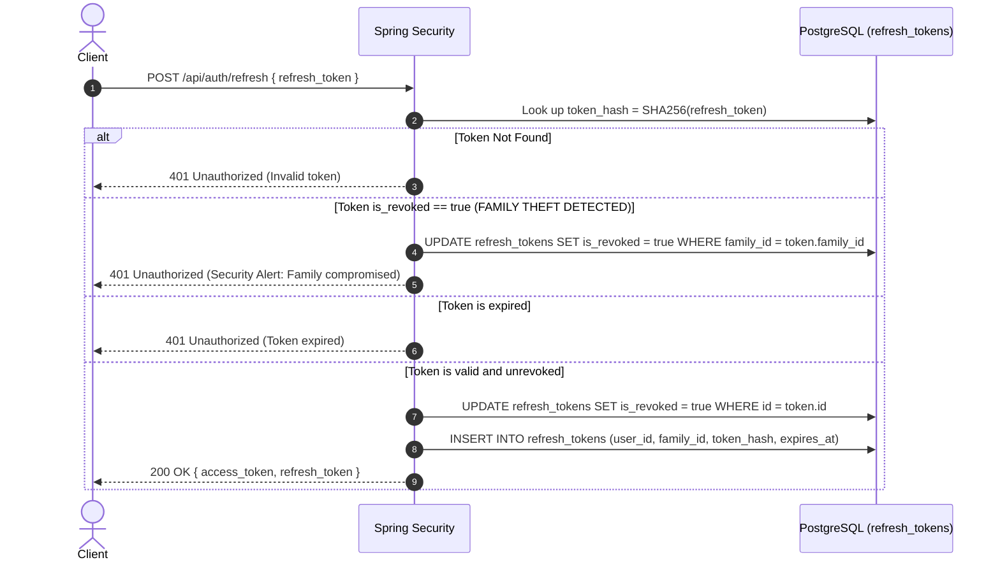

# Enterprise Security Parity Plan: Python/FastAPI to Java/Spring Boot
**Platform:** CompanyAudit — Enterprise Audit & Performance Analytics Platform  
**Target Security Framework:** Spring Security 6.4.x | Bouncy Castle | JJWT 0.12.6 | Bucket4j 8.10.x  
**Security Standard:** OWASP Top 10 | SOC 2 Type II | ISO/IEC 27001 Fiduciary Controls  
**Document Classification:** Cryptographic & Security Parity Technical Blueprint  
**Deliverable ID:** PHASE0-DELIV-05

---

## 1. Executive Summary & Zero-Drift Security Guarantee

The migration of CompanyAudit from Python 3.13 / FastAPI to Java 17/21 / Spring Boot 3.4 must guarantee **absolute zero security regression**. Existing user credentials, active sessions, refresh tokens, role-based access rules, tenant boundaries, and audit cryptographic proofs must operate seamlessly without requiring user password resets or database modifications.

---

## 2. Authentication & Cryptographic Parity

### 2.1 Password Hashing Parity (Argon2id)

The Python backend hashes passwords using `pwdlib.PasswordHash` with `Argon2Hasher`. The generated hashes conform to the PHC string format:
```
$argon2id$v=19$m=65536,t=3,p=4$<salt>$<hash>
```

#### Parameter Parity Specification

| Parameter | Python (`pwdlib`) Config | Java (`Argon2PasswordEncoder`) Config | Status |
| :--- | :--- | :--- | :--- |
| **Algorithm Variant** | Argon2id | Argon2id (`Argon2PasswordEncoder`) | **Identical** |
| **Salt Length** | 16 bytes (128 bits) | `saltLength = 16` | **Identical** |
| **Hash Length** | 32 bytes (256 bits) | `hashLength = 32` | **Identical** |
| **Parallelism ($p$)**| 4 lanes | `parallelism = 4` | **Identical** |
| **Memory Cost ($m$)**| 65536 KiB (64 MiB) | `memory = 65536` | **Identical** |
| **Iterations ($t$)** | 3 passes | `iterations = 3` | **Identical** |

#### Spring Security Bean Definition

```java
package io.companyaudit.platform.config;

import org.springframework.context.annotation.Bean;
import org.springframework.context.annotation.Configuration;
import org.springframework.security.crypto.argon2.Argon2PasswordEncoder;
import org.springframework.security.crypto.password.PasswordEncoder;

@Configuration
public class SecurityCryptoConfig {

    @Bean
    public PasswordEncoder passwordEncoder() {
        // saltLength: 16, hashLength: 32, parallelism: 4, memory: 65536 KiB, iterations: 3
        return new Argon2PasswordEncoder(16, 32, 4, 65536, 3);
    }
}
```

#### Account Lockout Enforcement
Matching Python's brute-force defense in `app/services/auth_service.py`:
1. Each failed login increments `users.failed_login_attempts`.
2. When `failed_login_attempts >= 5`, `users.locked_until` is set to `OffsetDateTime.now().plusMinutes(15)`.
3. Subsequent login attempts return HTTP 423 Locked or HTTP 401 with lockout message until the lockout expires.
4. A successful login resets `failed_login_attempts = 0` and clears `locked_until`.

---

## 3. JWT Architecture & Token Lifecycle

### 3.1 Claims Schema & Signing Compatibility

Both backends use HMAC-SHA256 (HS256) with the shared secret `JWT_SECRET_KEY`.

#### Access Token Claims Payload
```json
{
  "sub": "c1f7274b-5136-4c40-bbd9-95a94a2ee6f8",
  "cid": "a1b2c3d4-e5f6-7a8b-9c0d-1e2f3a4b5c6d",
  "role": "Admin",
  "ver": 1,
  "type": "access",
  "jti": "8f9a2e4b-7c1d-4e9f-8a2b-3c4d5e6f7a8b",
  "iat": 1732185600,
  "exp": 1732187400
}
```

#### Claim Invariants
- `sub`: User UUID as string.
- `cid`: Company UUID as string (null for SuperAdmin).
- `role`: Role string (`SuperAdmin`, `Admin`, `Auditor`, `DepartmentHead`, `Auditee`).
- `ver`: Current `users.token_version` (integer).
- `type`: Must be `"access"`.
- `jti`: Random UUID string for token replay prevention.
- `exp`: Epoch seconds, 30 minutes (1800s) lifetime.

### 3.2 Token Version Invalidation (Session Revocation)
When an administrator revokes a user's access or resets their password, `users.token_version` increments by 1. The Spring Security `JwtAuthenticationFilter` queries or caches the user's active version; if `claims.get("ver", Integer.class) < user.getTokenVersion()`, the request is immediately rejected with HTTP 401 Unauthorized.

---

## 4. Refresh Token Rotation & Family Reuse Detection

To prevent stolen refresh tokens from maintaining persistent access, the platform implements **Refresh Token Family Rotation**:



### Key Guarantees
1. Refresh tokens are never stored in plain text. Only `SHA-256(token)` is persisted.
2. The `family_id` links all descendant tokens across consecutive rotations.
3. If an already-used token is presented a second time (indicating an attacker intercepted it), the backend **invalidates the entire token family**, forcing the legitimate user and attacker to re-authenticate.

---

## 5. Double-Submit CSRF & Origin Defense

FastAPI enforces CSRF protection on state-changing requests via double-submit cookie validation. Spring Security replicates this behavior exactly:

1. **CSRF Cookie:** Name `csrf_token`, HttpOnly = false, SameSite = Lax, Secure = true (production), Path = `/`.
2. **CSRF Header:** `X-CSRF-Token`.
3. **Protected Methods:** `POST`, `PUT`, `PATCH`, `DELETE`.
4. **Exempt Paths:**
   - `/api/auth/login` (Initial session establishment)
   - `/api/auth/refresh` (Token exchange)
   - `/api/health` (Monitoring probe)
5. **Validation Rule:**
   ```java
   String cookieToken = extractCookie(request, "csrf_token");
   String headerToken = request.getHeader("X-CSRF-Token");
   if (cookieToken == null || !cookieToken.equals(headerToken)) {
       throw new CsrfException("Invalid or missing CSRF token");
   }
   ```
6. **Origin / Referer Validation:**
   For cross-origin POST requests, the `Origin` or `Referer` header must match the whitelist defined in `app.security.cors.allowed-origins`.

---

## 6. Five-Role RBAC & Multi-Tenant Authorization

### 6.1 Role Hierarchy & Permissions

| Role | Company Scope | Department Scope | Key Permissions |
| :--- | :--- | :--- | :--- |
| **SuperAdmin** | Global (all companies) | All | System management, create companies, manage global settings |
| **Admin** | Own Company | All | Company users, departments, SLA policies, audit templates, risk oversight |
| **Auditor** | Own Company | All | Create/execute audits, answer checklists, create findings, view risks |
| **DepartmentHead** | Own Company | Own Department | View department audits, sign off findings, view department risks |
| **Auditee** | Own Company | Own Department | View assigned corrective actions, submit action updates and evidence |

### 6.2 Method-Level Security Enforcement

```java
@PreAuthorize("hasRole('SuperAdmin') or (hasRole('Admin') and #companyId == authentication.principal.companyId)")
public CompanyResponse getCompanyDetails(UUID companyId) { ... }

@PreAuthorize("hasAnyRole('Admin', 'Auditor')")
public FindingResponse createFinding(UUID auditId, CreateFindingRequest request) { ... }

@PreAuthorize("hasRole('DepartmentHead') and #deptId == authentication.principal.departmentId")
public void signOffDepartmentFinding(UUID findingId, UUID deptId) { ... }
```

### 6.3 Department Row Confinement
For users with roles `DepartmentHead` or `Auditee`, repository queries automatically inject:
```sql
WHERE company_id = :userCompanyId AND department_id = :userDepartmentId
```
Preventing horizontal privilege escalation between departments.

---

## 7. Evidence File Security & SHA-256 Integrity

Evidence files (documents, images, logs) uploaded to `/api/audits/{id}/evidence` or `/api/findings/{id}/evidence`:
1. **Size Restriction:** Maximum 25 MiB per file.
2. **MIME Type Validation:** Inspected with **Apache Tika** (magic bytes inspection) rather than trusting client-supplied `Content-Type`. Executable types (`application/x-dosexec`, `.sh`, `.bat`, `.dll`) are strictly rejected.
3. **SHA-256 Verification:** The SHA-256 digest is calculated during file streaming:
   ```java
   MessageDigest digest = MessageDigest.getInstance("SHA-256");
   try (DigestInputStream dis = new DigestInputStream(multipartFile.getInputStream(), digest);
        OutputStream os = Files.newOutputStream(targetPath)) {
       dis.transferTo(os);
   }
   String computedSha = HexFormat.of().formatHex(digest.digest());
   ```
4. **Path Traversal Defense:** Filenames are sanitized, stripping directory traversal characters (`..`, `/`, `\`), and stored under UUID-based storage paths.

---

## 8. Redacted Structured Logging & Audit Trail

To prevent sensitive credentials and PII from leaking into logs:
1. **Logback Masking:** `logback-spring.xml` configures regex masking for passwords, authorization tokens, refresh tokens, and credit card / national identifiers.
2. **Audit History Logging:** All state modifications record an immutable row in `audit_history` with the user ID, timestamp, entity change diff, and SHA-256 hash.
