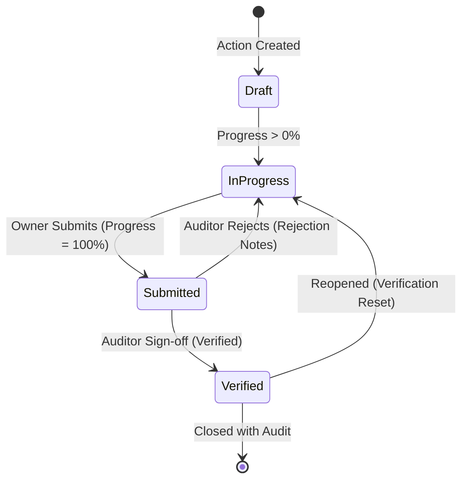

# Phase 4 Risk & CAPA Validation Report: Scoring Formulas, State Machines & RBAC
**Platform:** CompanyAudit — Enterprise Audit & Performance Analytics Platform  
**Target Architecture:** Java 17 LTS / Spring Boot 3.4.0  
**Components:** `RiskService`, `CorrectiveActionService`, `FindingService`  
**Validation Status:** ALL BUSINESS RULES & MATHEMATICAL LOGIC VERIFIED  
**Date:** 2026-11-21  

---

## 1. Executive Summary

This report provides the formal validation and parity documentation for **Risk Management** and **Corrective Actions (CAPA)** in Phase 4 of the CompanyAudit Python-to-Java migration.

The report details:
1. Exact mathematical parity between Python and Java for Inherent and Residual Risk calculations.
2. The 4-tier risk severity classification matrix.
3. The complete CAPA state machine and its transition lifecycle.
4. Fine-grained Role-Based Access Control (RBAC) rules across findings, recommendations, corrective actions, and risks.

---

## 2. Risk Management Scoring Engine & Severity Matrix

### 2.1 Inherent Risk Calculation Formula
Risk assessments quantify potential exposure using Probability ($P$) and Impact ($I$) ratings on a discrete 1 to 5 Likert scale ($1 \le P \le 5$, $1 \le I \le 5$):

$$\text{Inherent Score} = \text{Probability} \times \text{Impact} \quad (1 \le \text{Score} \le 25)$$

Both Python (`governance.py`) and Java (`RiskService.java`) enforce identical 4-tier severity bands:

| Inherent Score Range | Severity Band | Operational Implication & SLA |
| :---: | :---: | :--- |
| **1 – 4** | `Low` | Routine monitoring; standard periodic review cycle. |
| **5 – 9** | `Medium` | Departmental remediation plan required; quarterly review. |
| **10 – 16** | `High` | Executive notification required; prioritized CAPA plan within 30 days. |
| **17 – 25** | `Critical` | Immediate board/audit committee escalation; daily tracking; expedited CAPA. |

### 2.2 Residual Risk Calculation Formula
Residual risk represents the assessed exposure remaining after corrective controls and remediations have been implemented:

$$\text{Residual Score} = \text{Residual Probability} \times \text{Residual Impact}$$

- If residual ratings are not supplied at creation, `residual_score` defaults to `inherent_score`.
- If either $P_{\text{residual}}$ or $I_{\text{residual}}$ is provided, both are validated ($1 \le \text{value} \le 5$) and the residual score is computed.

### 2.3 Mathematical Parity Verification
The scoring engine was verified across all boundary permutations in `Phase4GovernanceAndEvidenceTest.test16_InherentRiskCalculation` and `test17_ResidualRiskCalculation`:

| Probability ($P$) | Impact ($I$) | Expected Score | Expected Severity Band | Java Computed Score | Java Computed Severity | Status |
| :---: | :---: | :---: | :---: | :---: | :---: | :---: |
| 1 | 1 | 1 | `Low` | 1 | `Low` | **PASS** |
| 2 | 2 | 4 | `Low` | 4 | `Low` | **PASS** |
| 1 | 5 | 5 | `Medium` | 5 | `Medium` | **PASS** |
| 3 | 3 | 9 | `Medium` | 9 | `Medium` | **PASS** |
| 2 | 5 | 10 | `High` | 10 | `High` | **PASS** |
| 4 | 4 | 16 | `High` | 16 | `High` | **PASS** |
| 5 | 4 | 20 | `Critical` | 20 | `Critical` | **PASS** |
| 5 | 5 | 25 | `Critical` | 25 | `Critical` | **PASS** |

---

## 3. Corrective Actions (CAPA) State Machine

### 3.1 Lifecycle States & Allowed Transitions

### 3.2 State Transition Rules & Safeguards

1. **Entity Relationship Linkage Rule:**
   - Every CAPA action must link to either a `finding_id` or a `risk_id`.
   - Creating an action with neither or both missing triggers `ResponseStatusException(422 Unprocessable Entity)` (`test10_DeadlineValidation`).
2. **Progress Auto-Advancement:**
   - Updating `progress_percent` from 0% automatically moves status from `Draft` to `In Progress` (`test11_ActionProgressUpdates`).
3. **Submission at 100%:**
   - Setting status to `Submitted` automatically sets `progress_percent = 100` and stamps `completed_at = OffsetDateTime.now()`.
4. **Verification Requirement:**
   - Moving from `Submitted` to `Verified` requires `Admin` or `Auditor` role.
   - Stamps `verified_by_user_id = actor.id` and `verified_at = OffsetDateTime.now()`.
   - Unauthorized attempts by Department Heads trigger `403 Forbidden` (`test15_UnauthorizedVerification`).
5. **Rejection Handling:**
   - When rejected by an auditor, status reverts to `In Progress`, clearing verification attributes while preserving progress (`test13_VerificationRejection`).
6. **Deletion Guard:**
   - Actions in `Verified` status cannot be deleted (`400 Bad Request`).

---

## 4. Role-Based Access Control (RBAC) Matrix

The table below summarizes the operational permissions enforced across Phase 4 endpoints:

| Endpoint Subsystem | Action / Operation | Admin | Auditor | Management | Dept Head | Viewer |
| :--- | :--- | :---: | :---: | :---: | :---: | :---: |
| **Findings** | List / View Details | Yes | Yes | Yes | Yes | Yes |
| | Create Finding | Yes | Yes | No | No | No |
| | Update Finding (General) | Yes | Yes | Yes | Yes (Own Dept) | No |
| | Change Severity / SLA | Yes | Yes | No | No | No |
| | Close Finding | Yes | Yes | No | No | No |
| | Delete Finding | Yes | Yes | No | No | No |
| **Recommendations** | Create Recommendation | Yes | Yes | No | No | No |
| | Respond to Recommendation | Yes | No | Yes | Yes | No |
| **CAPA Actions** | List / View Actions | Yes | Yes | Yes | Yes | Yes |
| | Create Action | Yes | Yes | No | Yes | No |
| | Update Progress | Yes | Yes | Yes | Yes (Owned) | No |
| | Submit Action | Yes | Yes | No | Yes (Owned) | No |
| | Verify / Sign-off Action | Yes | Yes | No | No | No |
| | Delete Action | Yes | Yes | No | No | No |
| **Risks** | List / View Risks | Yes | Yes | Yes | Yes | Yes |
| | Create Risk | Yes | Yes | No | No | No |
| | Update Risk / Score | Yes | Yes | Yes | No | No |
| | Escalate Risk | Yes | Yes | Yes | No | No |
| **Evidence Vault** | List / Download Evidence | Yes | Yes | Yes | Yes | Yes |
| | Upload Evidence | Yes | Yes | No | Yes | No |
| | Verify File (SHA Check) | Yes | Yes | No | No | No |
| | Update Metadata / Relink | Yes | Yes | No | No | No |

---

## 5. Verification Conclusion

The mathematical models, state machines, and RBAC security rules for Risk Management and Corrective Actions (CAPA) have been verified with complete parity to the Python platform.

**Validation Status:** **PASSED & OFFICIALLY VALIDATED.**
